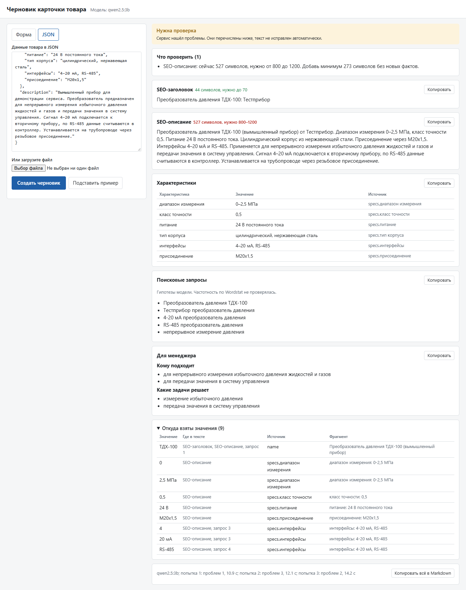
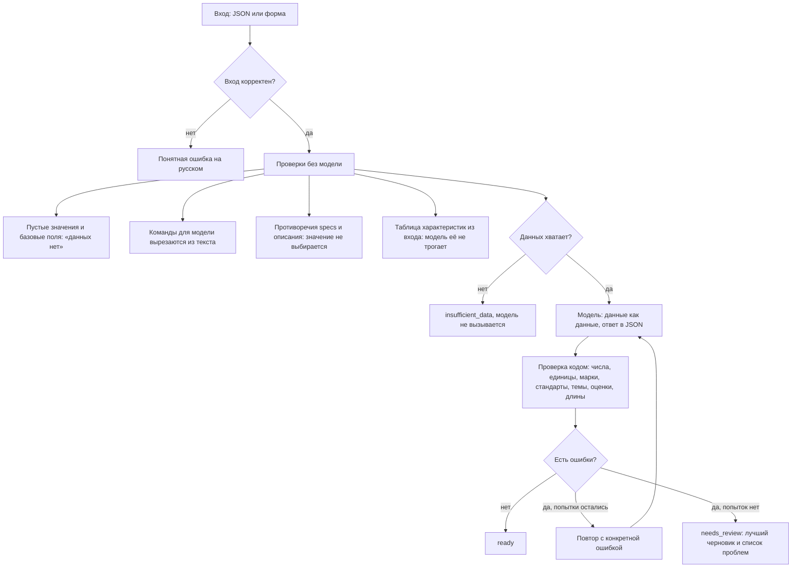

# Помощник для карточек товара

Сервис получает данные о контрольно-измерительном приборе и делает черновик карточки для B2B-магазина: SEO-заголовок, SEO-описание, таблицу характеристик, поисковые запросы и блок для менеджера.

Обычная обёртка над API не подойдёт: модель может уверенно написать чужой класс точности, а цена ошибки в карточке прибора высокая. Поэтому главное здесь проверка. Код сверяет каждое число, единицу, марку и стандарт из текста модели со входными данными и показывает контент-менеджеру, откуда взято каждое значение, чего не хватает и что надо проверить.

Прототип сделан как тестовое задание. На реальном каталоге и в проде он не работал. Все данные в репозитории тестовые. Проект сделан с AI-ассистентом, решения я разобрал и могу защитить.



На скриншоте настоящий запуск на вымышленном приборе с локальной моделью `qwen2.5:3b`. Карточка ушла на проверку: модель написала слишком короткое описание, и сервис об этом сообщил.

## Запуск на Windows

Нужен Python 3.11 или новее.

```bash
git clone https://github.com/Yarik002/product-card-assistant.git
```
```bash
cd product-card-assistant
```
```bash
py -3.11 -m venv .venv
```
```bash
.venv\Scripts\python -m pip install -r requirements.txt
```
```bash
copy .env.example .env
```

Откройте `.env` и впишите ключ в `LLM_API_KEY`. Ключ Gemini можно получить в [Google AI Studio](https://aistudio.google.com/apikey). Запуск:

```bash
.venv\Scripts\python -m uvicorn card_assistant.web:app --port 8000
```

Страница откроется по адресу http://localhost:8000. Кнопка «Подставить пример» заполнит форму манометром из задания.

**Без ключа, на локальной модели.** Установите [Ollama](https://ollama.com), скачайте модель командой `ollama pull qwen2.5:3b`, а в `.env` замените строки на такие:

```
LLM_BASE_URL=http://localhost:11434/v1
LLM_MODEL=qwen2.5:3b
LLM_API_KEY=
```

**Совсем без модели.** Проверка данных и таблица характеристик работают и так:

```bash
.venv\Scripts\python -m card_assistant.cli check data\products\incomplete_thermometer.json
```

**Через Docker** (нужен файл `.env`):

```bash
docker compose up --build
```

Чтобы контейнер видел Ollama на компьютере, в `.env` укажите `LLM_BASE_URL=http://host.docker.internal:11434/v1`.

## Команды

| Что сделать | Команда |
|---|---|
| Карточка по файлу, Markdown | `.venv\Scripts\python -m card_assistant.cli generate data\products\manometer_dm02.json` |
| То же в JSON | добавить `--json` |
| Пересобрать все примеры из `data/products/` | `.venv\Scripts\python -m card_assistant.cli regenerate` |
| Прогнать eval | `.venv\Scripts\python -m evals.run --label имя` |
| Тесты | `.venv\Scripts\python -m pip install -r requirements-dev.txt`, затем `.venv\Scripts\python -m pytest` |

## Пример

Вход, манометр из задания ([файл](data/products/manometer_dm02.json)):

```json
{
  "name": "Манометр показывающий DM 02",
  "manufacturer": "Манотомь",
  "specs": {
    "диапазон измерений": "0–1,6 МПа",
    "класс точности": "1,5",
    "присоединение": "G1/2",
    "диаметр корпуса": "100 мм"
  },
  "description": "Прибор предназначен для измерения избыточного давления..."
}
```

Начало выхода, настоящий запуск на `qwen2.5:3b` ([вся карточка](examples/manometer_dm02.card.md)):

```
Статус: нужна проверка

Что проверить
- SEO-описание: сейчас 521 символов, нужно от 800 до 1200. Добавь минимум 279 символов без новых фактов.
- SEO-описание: во входе нет данных о теме «отрасли применения». Убери упоминание.

Не хватает данных
- питание: нет во входных данных
- тип корпуса: нет во входных данных
- интерфейсы: нет во входных данных
```

Модель сама дописала «нефтехимия, металлургия и транспортировка газа». Сервис это заметил и не выдал такой текст за готовый.

Примеры лежат в [examples/](examples/):

| Файл | Что это |
|---|---|
| `manometer_dm02` | Манометр из примера в задании |
| `fictional_pressure_transmitter_tdx100` | Вымышленный прибор с заполненными базовыми полями |
| `incomplete_thermometer` | Вымышленный прибор с неполными данными |

**Это тестовые данные, а не данные из задания.** Данные двух товаров от компании я пока не получил. Когда они будут, файлы кладутся в `data/products/`, примеры пересобираются одной командой.

## Как устроена защита от выдумок



Текст никогда не обрезается и не дополняется кодом. Если есть противоречие или инъекция, карточка идёт на проверку, даже если текст чистый. Запросы это гипотезы модели: по Wordstat они не проверялись.

Промпты и причины решений описаны в [docs/DECISIONS.md](docs/DECISIONS.md), настоящие сложности в [docs/NOTES.md](docs/NOTES.md).

## Результаты eval

Набор из 15 случаев лежит в [evals/cases.py](evals/cases.py): полные и неполные данные, противоречия, инъекции, мусор, длинный паспорт, битый JSON и соблазн дописать прибор из памяти. Команда прогоняет их на настоящей модели.

Модель `qwen2.5:3b` (Ollama, ноутбук с GTX 1650 на 4 ГБ), 2 ноября 2026. [Полный отчёт](evals/results/qwen2.5-3b.md), [все тексты](evals/results/qwen2.5-3b.json).

| Показатель | Значение |
|---|---|
| Ожидания к сервису выполнены | 15 из 15 |
| `ready` | 0 |
| `needs_review` | 12 |
| `insufficient_data`, модель не вызывалась | 2 |
| Отклонён некорректный вход | 1 |
| Дошло до повторов | 12 из 12 карточек |
| Срабатываний на выдумки за все попытки | 85 |
| Из них числа и марки | 30 |
| Из них запрещённые темы | 31 |
| Из них оценки | 20 |
| Названия | 4 |
| Запрещённых строк в итоговых черновиках | 3 |
| Из них валидатор не сообщил | 2 |
| Медиана времени на попытку | 10,9 с |

Как это читать. Ни одна карточка на этой модели не стала `ready`: она пишет слишком коротко и часто дописывает лишнее. Поэтому локальная модель такого размера для этой задачи не годится, а сервис честно это показывает. Срабатывания считаются по всем попыткам, одна и та же фраза может попасть в счёт несколько раз.

**Сравнение с облачной моделью пока не проведено.** Режим Gemini задан в настройках, но с настоящим ключом не проверялся.

### Что осталось не поймано

Найдено чтением итоговых текстов, а не автоматически:

- В блоке предположений модель написала «не требуется гарантия, не требуется сертификаты». Темы в предположениях намеренно не проверяются, поэтому это те самые 2 строки, о которых валидатор не сообщил.
- «Контроль давления в системах водоснабжения, газоснабжения, отопления». Такого нет во входе, но и запрещённого слова тоже нет. Фраза попала только в список со слабой опорой на вход.
- Нефтехимия: список отраслей конечный, этого слова в нём нет.
- В длинном паспорте про преобразователь модель назвала манометр преобразователем. Текст прошёл проверки, карточка была на проверке только из-за противоречия.

## Ограничения

- Проверка находит факты, а не смысл. Утверждение без чисел и слов из списков может пройти.
- Числа словами не проверяются. Выдуманная марка в начале предложения может пройти.
- Инъекция другими словами может не найтись шаблоном.
- Привязка числа к параметру работает только для короткого списка параметров.
- Поисковые запросы не проверены по Wordstat.
- Сервис не проверялся на реальном каталоге.

Подробнее и про улучшения (RAG по паспортам, модель в замкнутом контуре, выгрузка в 1С-Битрикс, Wordstat, сбор правок контент-менеджеров) в [docs/DECISIONS.md](docs/DECISIONS.md).
