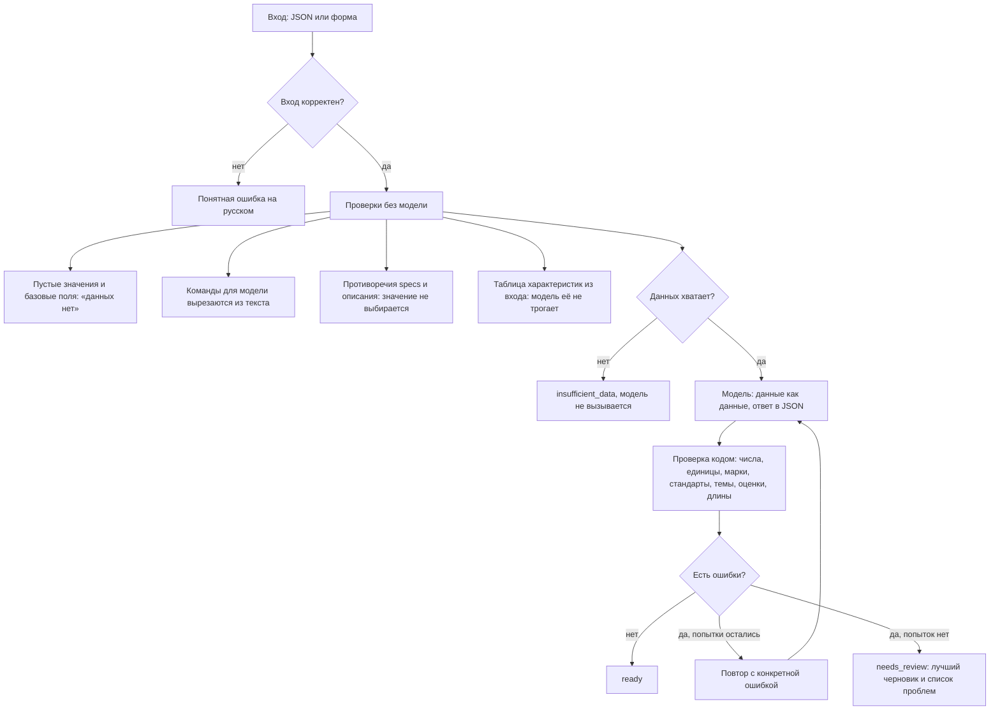

# Помощник для карточек товара

[](https://github.com/Yarik002/product-card-assistant/actions/workflows/ci.yml)

Сервис получает данные о контрольно-измерительном приборе и делает черновик карточки для B2B-магазина: SEO-заголовок, SEO-описание, таблицу характеристик, поисковые запросы и блок для менеджера.

Обычная обёртка над API не подойдёт: модель может уверенно написать чужой класс точности, а цена ошибки в карточке прибора высокая. Поэтому главное здесь проверка. Код сверяет каждое число, единицу, марку и стандарт из текста модели со входными данными и показывает контент-менеджеру, откуда взято каждое значение, чего не хватает и что надо проверить.

Прототип сделан как тестовое задание. На реальном каталоге и в проде он не работал. Все данные в репозитории тестовые. Проект сделан с AI-ассистентом, решения я разобрал и могу защитить.


На скриншоте настоящий запуск: манометр из задания, модель `nvidia/nemotron-3.5-super-vl:free`.

## Запуск на Windows

Нужен Python 3.11 или новее. Проверено на 3.11 и 3.14: если у вас другая версия, в команде ниже укажите её.

```bash
git clone https://github.com/Yarik002/product-card-assistant.git
```
```bash
cd product-card-assistant
```
```bash
py -3.11 -m venv .venv
```
```bash
.venv\Scripts\python -m pip install -r requirements.txt
```
```bash
copy .env.example .env
```

Откройте `.env` и впишите ключ в `LLM_API_KEY`. Ключ можно получить на [OpenRouter](https://openrouter.ai/keys), указанная модель бесплатная, но с лимитом запросов в день. Запуск:

```bash
.venv\Scripts\python -m uvicorn card_assistant.web:app --port 8000
```

Страница откроется по адресу http://localhost:8000. Кнопка «Подставить пример» заполнит форму манометром из задания.

**Без ключа, на локальной модели.** Установите [Ollama](https://ollama.com), скачайте модель командой `ollama pull qwen2.5:3b` и замените строки в `.env` на такие:

```
LLM_BASE_URL=http://localhost:11434/v1
LLM_MODEL=qwen2.5:3b
LLM_API_KEY=
LLM_EXTRA_BODY=
```

**Совсем без модели и ключа.** Проверка данных и таблица характеристик работают и так, а готовые карточки лежат в [examples/](examples/):

```bash
.venv\Scripts\python -m card_assistant.cli check data\products\incomplete_thermometer.json
```

**Через Docker** (нужен файл `.env`):

```bash
docker compose up --build
```

Чтобы контейнер видел Ollama на компьютере, в `.env` укажите `LLM_BASE_URL=http://host.docker.internal:11434/v1`.

## Команды

| Что сделать | Команда |
|---|---|
| Карточка по файлу, Markdown | `.venv\Scripts\python -m card_assistant.cli generate data\products\manometer_dm02.json` |
| То же в JSON | добавить `--json` |
| Пересобрать все примеры из `data/products/` | `.venv\Scripts\python -m card_assistant.cli regenerate` |
| Прогнать eval | `.venv\Scripts\python -m evals.run --label имя` |
| Тесты | `.venv\Scripts\python -m pip install -r requirements-dev.txt`, затем `.venv\Scripts\python -m pytest` |

## Пример

Вход, манометр из задания ([файл](data/products/manometer_dm02.json)):

```json
{
  "name": "Манометр показывающий DM 02",
  "manufacturer": "Манотомь",
  "specs": {
    "диапазон измерений": "0–1,6 МПа",
    "класс точности": "1,5",
    "присоединение": "G1/2",
    "диаметр корпуса": "100 мм"
  },
  "description": "Прибор предназначен для измерения избыточного давления..."
}
```

Выход без правок, настоящий запуск ([вся карточка](examples/manometer_dm02.card.md)):

```
Статус: готово

Не хватает данных
- питание: нет во входных данных
- тип корпуса: нет во входных данных
- интерфейсы: нет во входных данных

SEO-заголовок (46 символов)
Манометр показывающий DM 02 Манотомь 0–1,6 МПа

SEO-описание (883 символов)
Манометр показывающий DM 02, производитель Манотомь, предназначен для измерения избыточного давления.

Диапазон измерений 0–1,6 МПа.
Класс точности 1,5.
Присоединение G1/2.
Диаметр корпуса 100 мм.

Прибор контролирует избыточное давление в системах и используется для отображения текущего значения на циферблате.

Диапазон измерений определяет, какие значения давления может фиксировать прибор. [...]

Кому подходит: тем, кому нужно измерять избыточное давление
Какие задачи решает: измерение избыточного давления
```

Текст получается суховатым и местами однообразным: при таких коротких данных это цена отсутствия выдумок. Это черновик, контент-менеджер его дорабатывает.

Примеры лежат в [examples/](examples/):

| Файл | Что это | Статус |
|---|---|---|
| `manometer_dm02` | Манометр из примера в задании | готово |
| `fictional_pressure_transmitter_tdx100` | Вымышленный прибор с заполненными базовыми полями | готово |
| `incomplete_thermometer` | Вымышленный прибор с неполными данными | нужна проверка |

**Это тестовые данные, а не данные из задания.** Данных двух товаров от компании у меня пока нет. Когда они будут, файлы кладутся в `data/products/`, примеры пересобираются одной командой.

## Как устроена защита от выдумок



Текст никогда не обрезается и не дополняется кодом. Если есть противоречие или инъекция, карточка идёт на проверку, даже если текст чистый. Запросы это гипотезы модели: по Wordstat они не проверялись.

Промпты и причины решений описаны в [docs/DECISIONS.md](docs/DECISIONS.md), настоящие сложности в [docs/NOTES.md](docs/NOTES.md).

## Результаты eval

Набор из 15 случаев лежит в [evals/cases.py](evals/cases.py): полные и неполные данные, противоречия, инъекции, мусор, длинный паспорт, битый JSON и соблазн дописать прибор из памяти. Команда прогоняет их на настоящей модели. Обе модели прогнаны 3 ноября 2026 на финальном коде.

| Показатель | `nemotron-3.5-super-vl:free`, облако | `qwen2.5:3b`, Ollama на ноутбуке с GTX 1650 на 4 ГБ |
|---|---|---|
| Ожидания к сервису выполнены | 15 из 15 | 15 из 15 |
| `ready` | 2 | 0 |
| `needs_review` | 10 | 12 |
| `insufficient_data`, модель не вызывалась | 2 | 2 |
| Отклонён некорректный вход | 1 | 1 |
| Дошло до повторов | 12 из 12 карточек | 12 из 12 карточек |
| Всего попыток | 31 | 36 |
| Срабатываний на выдумки за все попытки | 9 | 215 |
| Ошибки длины, повторы и другие за все попытки | 27 | 42 |
| Запрещённых строк в итоговых черновиках | 0 | 4, все отмечены валидатором |
| Медиана времени на попытку | 2,7 с | 12,5 с |
| Токенов всего | 53 411 | 77 809 |

Отчёты и все тексты: [облако](evals/results/nemotron-3.5-super-vl-free.md), [локальная модель](evals/results/qwen2.5-3b.md).

Как это читать:

- Облачная модель: из 10 карточек на проверке 8 ушли туда правильно. Это 6 ловушек с противоречиями и инъекциями (там `ready` невозможен, даже если текст чистый), мусорный вход и датчик без характеристик. Ещё 2 настоящие неудачи: описание короче 800 символов на неполных данных и у термометра с полными данными, модель не дотянула за три попытки.
- Локальная модель такого размера для этой задачи не годится: не набирает длину и много выдумывает. Например, по одному названию «Датчик давления Метран-150» она дописала «150 МПа», IP67 и диапазон температур. Всё это поймано, ни одна её карточка не прошла как готовая.
- Срабатывания считаются по всем попыткам, одна фраза может попасть в счёт несколько раз.
- Модель не детерминирована: между запусками статусы отдельных случаев меняются. В прогоне накануне на прежнем коде облако дало 4 `ready`. Цифры выше показывают один запуск, а не среднее.

Ещё был прогон на платной `google/gemini-3.5-flash-lite`, но на счёте закончились деньги. 7 случаев из 15 получили ошибку 402 и понятное сообщение вместо падения, поэтому прогон неполный и в сравнение не включён: [отчёт](evals/results/gemini-3.5-flash-lite-PARTIAL.md).

### Что осталось не поймано

Я прочитал все итоговые тексты облачной модели. Выдуманных чисел, марок и запрещённых тем в них нет, но есть общие сведения, которых во входе нет:

- «используется для отображения текущего значения на циферблате»: модель вывела это из слова «показывающий»;
- «капиллярного датчика», «Производитель влияет на совместимость с существующим оборудованием».

Такие фразы попадают только в блок «Прочитайте внимательно» со слабой опорой на вход. Список отраслей в проверке тоже конечный: в одном из ранних прогонов «нефтехимия» прошла мимо него.

## Ограничения

- Проверка находит факты, а не смысл. Утверждение без чисел и слов из списков может пройти.
- Числа словами не проверяются. Выдуманная марка в начале предложения может пройти.
- Инъекция другими словами может не найтись шаблоном.
- Привязка числа к параметру работает только для короткого списка параметров.
- Порог для общего текста подобран по этому же набору eval.
- Поисковые запросы не проверены по Wordstat.
- Сервис не проверялся на реальном каталоге.
- На бесплатной модели есть дневной лимит запросов. Для реальных паспортов нужна модель без передачи данных на внешний сервис.

Подробнее и про улучшения (RAG по паспортам, модель в замкнутом контуре, выгрузка в 1С-Битрикс, Wordstat, сбор правок контент-менеджеров) в [docs/DECISIONS.md](docs/DECISIONS.md).
